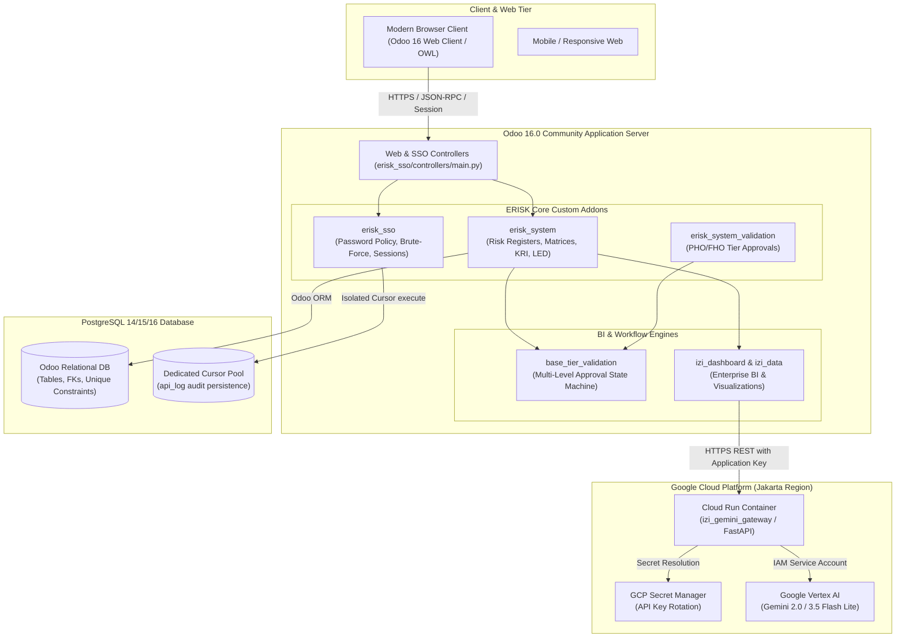

# Forensic Engineering Audit & Career Evidence Report: ERISK System
## Document 02: Technical Architecture & System Topography

- **Target Candidate:** Naufal Nabila
- **Target Repository:** `https://github.com/nusativ/erisk-system`
- **Audit Baseline Commit (HEAD):** `7e0c035acfe8263c0fee0dc8b152f059a12bc63f`
- **Auditor Role:** Senior Odoo Technical Architect

---

### 1. Architectural Topology: A Hybrid Enterprise Platform

The ERISK system is architectured not as a single monolithic Odoo module, but as a **Hybrid Enterprise Risk Management Platform** combining:
1. **A Core Custom Odoo Addon Suite** (`erisk_system`, `erisk_sso`, `erisk_system_validation`, `erisk_system_dashboard`).
2. **OCA (Odoo Community Association) & Extended Workflow Engines** (`base_tier_validation`, `base_tier_validation_formula`, `sequence_reset_period`, `report_xlsx`).
3. **An Integrated BI & Analytics Subsystem** (`izi_dashboard`, `izi_data`, `erisk_izi_dashboard`).
4. **An External Cloud Microservice** (`izi_gemini_gateway`) running on Google Cloud Run to provide Vertex AI / Gemini LLM capabilities with bounded latency and strict security boundaries.

---

### 2. Comprehensive Module Catalog & Attribution

The repository root contains 29 directories representing Odoo modules, deployment assets, and QA frameworks.

#### Category 1: Core Custom Addons (Primary Focus of ERISK)
| Module Name | Technical Purpose | Key Models Defined / Extended | Naufal's Forensic Ownership |
|---|---|---|---|
| [`erisk_system`](file:///c:/Users/Naska%20Jaladewa/Documents/naufal/erisk-system/erisk_system) | Core Enterprise Risk Management domain logic, risk registers, qualitative/quantitative impact scoring, KRI, LED, and strategic boundary lookups. | `nsv.risk.register`, `nsv.risk.update`, `nsv.risk.realisasi.treatment`, `nsv.risk.realisasi.kri`, `nsv.strategi.risiko`, `nsv.led`, `hr.department`. | **HIGH (18+ commits)**: Mathematical exposure formula, impact scoring helper, unlinking protection, KRI causes. |
| [`erisk_sso`](file:///c:/Users/Naska%20Jaladewa/Documents/naufal/erisk-system/erisk_sso) | Authentication hardening, enterprise password policies, login rate limiting, session security, password expiration crons, and custom login UI templates. | `res.users`, `api.log`, `ir.http` override, `res.config.settings`. | **VERY HIGH (85 commits)**: Dominant author of password enforcement, IP rate limiting, popup controllers, and headers. |
| [`erisk_system_validation`](file:///c:/Users/Naska%20Jaladewa/Documents/naufal/erisk-system/erisk_system_validation) | Approval workflows extending `base_tier_validation` for risk registers, risk updates, and construction project stage transitions (PHO/FHO). | `hr.department` (validation extension), `nsv.risk.register`, `comment.wizard`. | **HIGH (12+ commits)**: Primary author of PHO/FHO stage validation logic and rejection wizards. |
| [`erisk_system_dashboard`](file:///c:/Users/Naska%20Jaladewa/Documents/naufal/erisk-system/erisk_system_dashboard) | Custom dashboard UI widgets, risk heatmap matrix components, and scoreboard integration. | QWeb/OWL components (`main_box_card.xml`, matrix views). | **MEDIUM**: Fixed XML syntax structures and matrix boundaries. |
| [`erisk_api_rest`](file:///c:/Users/Naska%20Jaladewa/Documents/naufal/erisk-system/erisk_api_rest) | REST API endpoints for external data integration, Swagger UI documentation. | HTTP controllers, token auth handlers. | **LOW / PRESENT IN REPO**: Authored primarily by Amirul/Galang in 2024. |

#### Category 2: AI & Cloud Integration Assets
| Component | Technical Purpose | Technologies | Naufal's Forensic Ownership |
|---|---|---|---|
| [`izi_gemini_gateway`](file:///c:/Users/Naska%20Jaladewa/Documents/naufal/erisk-system/izi_gemini_gateway) | Standalone microservice translating Odoo IZI dashboard queries into structured Vertex AI prompts and safe JSON configurations. | Python 3.12, FastAPI, Pydantic v2, Google Vertex AI SDK. | **VERY HIGH (100% authored by Naufal)**: Commit `aa2b059`. |
| [`main.py`](file:///c:/Users/Naska%20Jaladewa/Documents/naufal/erisk-system/main.py) | WSGI-to-ASGI bridge enabling FastAPI execution on Google Cloud Run functions. | `a2wsgi`, `functions_framework`, Flask/Werkzeug adapter. | **VERY HIGH (100% authored by Naufal)**: Commit `aa2b059`. |
| [`deploy/gcp/`](file:///c:/Users/Naska%20Jaladewa/Documents/naufal/erisk-system/deploy/gcp) | Zero-downtime Cloud Run automated deployment script with Secret Manager integration. | Bash, Google Cloud SDK (`gcloud`), cURL, JSON assertions. | **VERY HIGH (100% authored by Naufal)**: Commit `aa2b059`. |

#### Category 3: Community & 3rd-Party Addons (Maintained in Tree)
| Module Name | Origin / Author | Purpose in System | Naufal's Ownership |
|---|---|---|---|
| `base_tier_validation` | OCA | Multi-level approval engine | Integrated & consumed |
| `base_tier_validation_formula` | OCA | Formula-based tier validation | Integrated & consumed |
| `izi_dashboard` / `izi_data` | IZI PT Solusi Usaha Mudah | Enterprise BI dashboard framework | Hardened security & SQL execution |
| `custom_gantt_view` / `project_custom_gantt` | Cybrosys Technologies | Project Gantt visualizations | Not touched by Naufal |
| `project_extended_7d` | Seventh Dimension | Dynamic Gantt for project tasks | Not touched by Naufal |
| `report_xlsx` | OCA | Excel report generation engine | Integrated |
| `sequence_reset_period` | OCA | Fiscal period sequence resets | Integrated |

---

### 3. Core Domain Data Model & Entity Relationships

The risk management domain model links organizational/project units with risk assessment, quantitative thresholds, and multi-tier approval states.

```mermaid
erDiagram
    HR_DEPARTMENT ||--o{ NSV_RISK_REGISTER : "owns / monitors"
    HR_DEPARTMENT ||--o{ NSV_DEPARTMENT_KOMPOSIT : "evaluates quarterly"
    HR_DEPARTMENT ||--o{ NSV_STRATEGI_RISIKO : "defines threshold"
    
    NSV_RISK_REGISTER ||--o{ NSV_RISK_UPDATE : "tracks periodic progress"
    NSV_RISK_REGISTER ||--o{ NSV_RISK_REALISASI_TREATMENT : "executes mitigation"
    NSV_RISK_REGISTER ||--o{ NSV_RISK_KEY_INDICATOR : "monitors KRI"
    NSV_RISK_REGISTER ||--o{ TIER_REVIEW : "approval stages"

    NSV_RISK_REALISASI_TREATMENT ||--o{ NSV_RISK_REALISASI_KRI : "records realization"
    NSV_RISK_REALISASI_KRI }o--o{ NSV_SETTING_CAUSE : "mitigates causes"
    
    HR_DEPARTMENT {
        int id PK
        string name
        string category "department | project"
        boolean is_tender
        string project_stage "active | pho | fho"
        float eat "Contract Value (Nilai Kontrak)"
        string id_number "Project / Dept Code"
    }

    NSV_RISK_REGISTER {
        int id PK
        string name "Register Code (e.g. R/10/2026/0034)"
        string state "draft | risk_assessment | approval_process | done"
        string risk_status "open | closed | expired | outstanding"
        float impact_amount "Direct Financial Impact"
        float eksposur_risk_value "Calculated Exposure"
        int impact_category_score "Scale 1-5"
        float probability_mid_value "Midpoint 0-100%"
        float impact_strategy_risk_limit "Risk Limit Threshold"
        int department_id FK
        int kpi_id FK
    }

    NSV_RISK_REALISASI_KRI {
        int id PK
        int realisasi_treatment_id FK
        int indicator_id FK
        string achievement_status
        m2m causing_ids "Explicit Selected Causes"
    }
```

#### Key Architectural Highlights of the Model Design:
1. **Polymorphic Project Hierarchy:** Instead of duplicating project metadata in `project.project`, ERISK unifies cost centers, business units, and construction project sites within an extended `hr.department` model (`erisk_system/models/hr_department.py:39-74`).
2. **Deterministic Exposure Calculation:** Computed fields decouple the stored financial exposure value from display formula strings, guaranteeing that formula text changes never cause accidental mass rewrites of historical audit logs (`erisk_system/models/risk_register.py:539-549`).
3. **Auditable Tier Reviews:** Integration with `tier.validation` ensures that all state transitions (`draft` $\rightarrow$ `done`, and `active` $\rightarrow$ `pho` $\rightarrow$ `fho`) leave an unalterable audit log with reviewer timestamps, user IDs, and formal rejection comments stored directly in the Odoo chatter.

