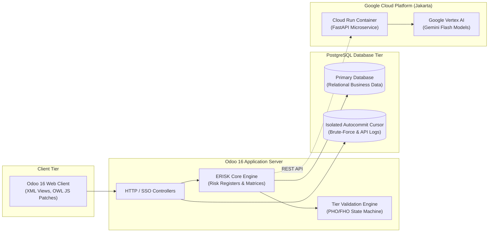

# Engineering Case Study: Enterprise Risk Management & Construction Governance Platform (ERISK)

**Role:** Core Odoo Backend, Security & Cloud Integration Engineer  
**Platform:** Odoo 16.0 Community, Python 3.12, PostgreSQL, Google Cloud Run, Vertex AI  
**Industry Domain:** Large-Scale Infrastructure & Construction Enterprise Governance  
**Engagement:** PT Nusa Teknologi Inovasi (Nusativ) for a Tier-1 Indonesian State-Owned Construction Enterprise  
**Timeframe:** 2025 – 2026  

---

## 1. Executive Summary & Problem Context

Large-scale infrastructure and state-owned construction contractors manage multi-billion-dollar project portfolios fraught with operational, contractual, financial, and safety risks. Traditional spreadsheet-based risk registers create operational blind spots: formulas are easily corrupted, approval chains lack cryptographic accountability, and project milestone transitions (such as site handovers) are decoupled from risk exposure assessments.

To address this challenge, our engineering team developed **ERISK**, an enterprise-grade Risk Management Information System built on **Odoo 16.0 Community**. The platform unifies corporate governance, tender evaluations, construction site risk tracking, and executive BI dashboards into a single auditable ecosystem.

As a **Core Backend and Security Developer**, I was responsible for delivering critical architecture subsystems:
1. Multi-tier construction project lifecycle automation (Active $\rightarrow$ PHO $\rightarrow$ FHO).
2. Enterprise authentication hardening, anti-brute-force rate limiting, and web security.
3. Deterministic quantitative risk impact evaluation and exposure modeling.
4. Cloud AI microservice integration connecting Odoo BI dashboards with Google Vertex AI.

---

## 2. System Architecture: A Resilient Hybrid Topology

The platform was architected with a decoupled, high-security topology ensuring that operational ERP transactions remain isolated from external AI workloads and sensitive database audit streams.

---

## 3. Key Engineering Challenges & Solutions

### Challenge 1: Modeling Construction Project Lifecycles with Multi-Tier Approvals
- **The Challenge:** In enterprise construction, projects transition through distinct contractual phases: Tender $\rightarrow$ Active Execution $\rightarrow$ Provisional Hand Over (PHO) $\rightarrow$ Final Hand Over (FHO). Handing over a project requires multi-level management sign-off, and rejections must record immutable explanations without allowing unauthorized stage skips.
- **The Engineering Solution:**
  - Extended Odoo's organizational hierarchy (`hr.department`) with project properties (`category='project'`, `eat` [Contract Value], and `is_tender`).
  - Integrated with `base_tier_validation` to establish a strict state machine (`active` $\rightarrow$ `pho` $\rightarrow$ `fho`).
  - Enforced transition constraints in the ORM `write()` method, preventing direct database manipulation.
  - Authored a custom rejection wizard (`ProjectStageCommentWizard`) requiring formal justification before a reviewer can reject a stage, with full audit history archived into the Odoo chatter.

---

### Challenge 2: Guaranteeing Audit Persistence During Authentication Failures
- **The Challenge:** To protect high-confidentiality risk registries against brute-force attacks, the system needed to record every failed login attempt and remote client IP address. However, when an authentication attempt fails in Odoo, the framework raises `AccessDenied`, which rolls back the active PostgreSQL transaction—erasing any standard ORM audit record created during the request.
- **The Engineering Solution:**
  - Designed an isolated cursor architecture in `api_log.py`.
  - Bypassed the active transaction pool by acquiring an independent database connection from the cursor pool (`cr = registry(dbname).cursor()`) with `cr._cnx.autocommit = True`.
  - Executed direct parameterized SQL writes that commit immediately to disk, ensuring that client IPs and attempt counters persist permanently even as the parent session aborts.

---

### Challenge 3: Eliminating Float Ambiguities in Contract Exposure Evaluations
- **The Challenge:** Enterprise risk exposure calculations evaluate estimated financial impact against contractual project limits:
  $$\text{Eksposur} = \text{Skala Dampak} \times \text{Nilai Tengah Probabilitas} \times 1\% \times \text{Batasan Risiko}$$
  Configured score intervals ($[0\%, 2.5\%)$, $[2.5\%, 5\%)$, etc.) suffered from floating-point rounding errors at boundary limits and non-deterministic ORM record ordering. Furthermore, updating display formulas threatened to rewrite historical stored financial values across thousands of existing audit records.
- **The Engineering Solution:**
  - Engineered an independent mathematical helper (`impact_scoring.py`) using order-independent normalized intervals and boundary floating-point tolerance (`math.isclose(..., rel_tol=1e-12)`).
  - Implemented strict exception handling for configuration gaps, overlapping intervals, and zero denominators.
  - Decoupled the stored financial exposure field from the UI display formula, and verified via Odoo ORM cache-invalidation tests (`record.invalidate_recordset()`) that formula updates never rewrite legacy database storage.

---

### Challenge 4: Secure AI Integration Without Cloud Token Overhead
- **The Challenge:** Enterprise users needed automated natural-language executive summaries on BI dashboards using Google Vertex AI. However, Odoo 16 cannot natively mint Google Cloud identity tokens, storing API keys in Odoo created security risks, and AI-generated SQL presented severe injection vulnerabilities.
- **The Engineering Solution:**
  - Architected a standalone microservice (`izi_gemini_gateway`) using Python 3.12, FastAPI, and Pydantic v2 schemas.
  - Deployed on Google Cloud Run with least-privilege IAM and high-entropy application keys managed via GCP Secret Manager.
  - Built an in-memory sliding-window rate limiter to strictly cap API costs.
  - Explicitly disabled generated SQL execution; the gateway only accepts structured metadata to synthesize natural-language chart commentary.
  - Authored a 209-line zero-downtime Bash deployment automation script (`deploy/gcp/deploy.sh`) managing candidate revisions and automated health checks.

---

## 4. Technologies & Tools Utilized

- **Core ERP Platform:** Odoo 16.0 Community Edition (ORM, Models, Wizards, XML Views, QWeb).
- **Web Client & Frontend:** Modern Odoo 16 OWL JavaScript Framework (`@web/core/utils/patch`, `FormController`), XML Templates.
- **Backend & Cloud:** Python 3.12, FastAPI, Pydantic v2, ASGI/WSGI Bridges (`a2wsgi`, `functions_framework`).
- **Database & Storage:** PostgreSQL 14/15/16, Direct SQL via `psycopg2.sql` (injection defense), Isolated autocommit cursors, Composite uniqueness constraints.
- **Infrastructure & DevOps:** Linux / Ubuntu CLI, Docker containerization, Google Cloud Run, GCP Secret Manager, Bash shell scripting.
- **Quality Assurance:** Odoo `TransactionCase` testing, Pytest, End-to-End browser automation with `@playwright/test`.

---

## 5. Engineering Impact & Business Outcomes

- **100% Audit Traceability on Project Milestones:** Eliminated unauthorized construction stage progression, ensuring all project handovers (PHO/FHO) have documented management sign-offs.
- **Zero-Downtime AI Deployment:** Fully automated Cloud Run deployment pipeline enabling instant rollback and automated pre-traffic health checks.
- **Robust Security Posture:** Completely closed Open Redirect vulnerabilities, enforced enterprise password complexity across all corporate users, and mitigated brute-force attempts with real-time IP rate limiting.
- **High Test Reliability:** Maintained 20+ automated backend transaction tests and Playwright browser regression suites, ensuring rapid feature turnaround without breaking legacy workflows.

---

## 6. Recommendations for Public Showcase & Screenshots

When showcasing this project publicly on a personal website or LinkedIn:
1. **Sanitize Enterprise Data:** Anonymize client names to *"Leading Indonesian State-Owned Construction & Infrastructure Enterprise"*.
2. **Recommended Safe Screenshots:**
   - Multi-tier PHO/FHO handover workflow buttons and chatter audit trail (using mock project data like *"Project Alpha - LRT Station"*).
   - 5x5 Risk Matrix Heatmap visualization (with synthetic risk events).
   - Automated password change modal showing client-side validation rules.
   - Terminal screenshot of the Playwright / Pytest test runner passing with zero errors.
3. **Architecture Diagrams:** Embed the sanitized Mermaid architecture flowchart above to demonstrate high-level systems thinking.

